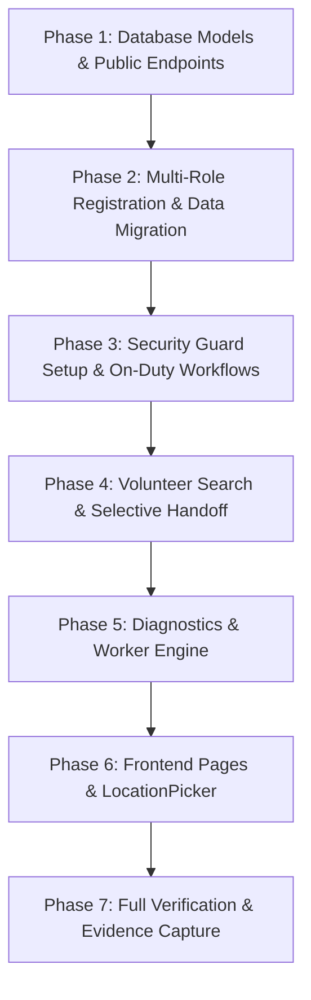

# SafeCircle Emergency Escalation Fix — Current State & Architectural Analysis

**Document Status:** Baseline Analysis & Implementation Blueprint  
**Date:** November 2026  
**Scope:** Backend (users, society, contacts, incidents, notifications), Frontend (registration, security workflow, guardian selection, staff approvals, dev runner).

---

## 1. Executive Summary

Milestone 3 implemented initial scaffolding for geolocation tracking, guardian acknowledgment, volunteer matching, and escalation timers. However, real-world execution revealed critical architectural gaps that prevent the escalation chain from executing successfully in practice:

1. **Disconnected Residents:** New residents register without selecting a society, block, or flat. `ResidentFlatMapping` can only be authored by admins. Consequently, `resident_society_ids` evaluates to an empty list `[]`, building security is omitted, and block-first volunteer matching fails to find candidates.
2. **Orphaned Security Personnel:** Security users are created without an associated `SocietyAssignment` (except when manually provisioned via `seed_demo.py`). Thus, societies report zero active security staff.
3. **Incomplete Volunteer Onboarding:** Volunteers register without providing their society, block, service area label, or base geolocation pin. `VolunteerProfile` is lazily instantiated with arbitrary defaults and remains unlinked from their true geographic service area.
4. **Passive Security & Static Switches:** Residents only have a boolean switch (`has_security_guard`), with no way to designate specific guards (society staff or personal building guards). Security personnel lack an on-duty toggle and have no dedicated emergency alert dispatch screen.
5. **Rigid Guardian Handoff:** Guardians who cannot respond are presented only with coarse category checkboxes. They cannot search, view, or individually designate nearby volunteers or security personnel.
6. **Silent Failure & Missing Diagnostics:** When an escalation dispatch alerts zero responders, the system fails silently without explaining why targets were omitted.

This document details the existing architecture, identifies root causes, and outlines the comprehensive fix plan.

---

## 2. Deep Dive: Current Backend State & Gaps

### 2.1 User Management & Registration (`users` app)
- **Current Model (`backend/users/models.py`):** `User` with roles `resident`, `guardian`, `volunteer`, `security`, `admin`. Unique normalized phone and case-insensitive username.
- **Current Registration (`UserRegistrationSerializer`):**
  - Accepts only `username`, `email`, `first_name`, `last_name`, `phone`, `role`, `password`, `confirm_password`.
  - Discards all geographic and society context at registration time.
- **Gaps to Address:**
  - Need unauthenticated public endpoints: `GET /api/public/societies/`, `GET /api/public/societies/{id}/blocks/`, `GET /api/public/blocks/{id}/flats/`.
  - Registration must process role-specific payloads atomically within `transaction.atomic()`:
    - `resident`: `society_id`, `block_id`, `flat_id`, optional home coordinates (`home_latitude`, `home_longitude`, `home_label`). Creates `ResidentFlatMapping`.
    - `volunteer`: `society_id`, optional `block_id`, `area_label`, required `base_latitude` & `base_longitude`, `max_travel_km` (default 3), `serves_nearby_societies`. Creates `VolunteerProfile` (pending) and `SocietyAssignment` (`is_active=False`, `is_available=True`).
    - `security`: `society_id`, `post_label`. Creates `SecurityProfile` (pending) and `SocietyAssignment` (`is_active=False`, `is_available=True`).
    - `guardian`: pure user creation.

### 2.2 Society, Profiles & Assignments (`society` app)
- **Current Models (`backend/society/models.py`):**
  - `Society`, `Block`, `Flat`, `ResidentFlatMapping`.
  - `SocietyAssignment`: links security/volunteer to a society with `is_active` and `is_available`.
  - `VolunteerProfile`: holds `latitude`, `longitude`, `pin_label`, `max_travel_km`, `approval_status`, etc.
  - Missing `SecurityProfile` model for security staff verification, assignment tracking, and post information.
- **Admin Approvals:**
  - Currently only handles volunteers (`AdminVolunteerListView`, `AdminVolunteerApproveView`, `AdminVolunteerRejectView`).
  - Must be broadened to "Staff Approvals" covering both Volunteers and Security Guards with pending, approved, and rejected tabs.
  - Far-pin warning logic (`SOCIETY_PIN_WARN_KM = 3.0`) must be surfaced on volunteer profiles.

### 2.3 Contacts & Resident Security Guards (`contacts` app)
- **Current Models (`backend/contacts/models.py`):**
  - `EmergencyContact`: handles primary and secondary guardians with acceptance lifecycle.
- **Missing Resident Security Model:**
  - Need `ResidentSecurityGuard` (`resident`, `name`, `phone`, `guard_type` (`society_security` vs `building_guard`), `linked_user` FK, `post_label`, `is_active`, `created_at`).
  - Endpoints: `GET/POST /api/resident/security-guards/`, `PATCH/DELETE /api/resident/security-guards/{id}/`, and `GET /api/resident/society-security/` to list approved security staff in the resident's society.
  - Derived `has_security_guard`: evaluated dynamically if resident has an active personal guard or the society has approved, on-duty security staff.

### 2.4 Incidents, Matching & Escalation (`incidents` app)
- **Matching (`backend/incidents/matching.py`):**
  - Selects volunteers block-first. Fails if resident has no active `ResidentFlatMapping`.
  - Need `GET /api/incidents/{id}/nearby-volunteers/?q=&radius_km=` accessible to verified guardians, resident, security, and admin.
  - Must return sanitized, privacy-safe volunteer summaries (`id`, `name`, `area_label`, `block`, `society`, `distance_km`, `within_travel_limit`, `source`, `tier`).
  - Must NEVER expose volunteer phone numbers or raw GPS coordinates.
- **Escalation Execution (`backend/incidents/escalation.py`):**
  - Extend `POST /api/incidents/{id}/handoff/` to accept `volunteer_ids`, `volunteer_mode` ("selected" vs "auto"), and `security_guard_ids`.
  - Enhance security dispatch: include approved on-duty society security, resident's linked society guards, and simulated SMS for unregistered building guards.
  - Implement `GET /api/incidents/{id}/escalation-diagnostics/` and management command `diagnose_escalation <id>` to record and explain why any group (secondary guardian, security, volunteers) was skipped.
  - Security acknowledgement: `POST /api/incidents/{id}/security-ack/` to set status `ACKNOWLEDGED`, record history, notify parties, and cancel escalation.
  - Duty toggle: `GET/PATCH /api/security/duty/` controlling `SocietyAssignment.is_available`.

### 2.5 Escalation Worker & Idempotency (`incidents/management/commands/`)
- Need robust background execution:
  - `run_escalation_worker`: 5-second polling loop checking overdue incidents (`escalate_at <= now()`).
  - Opportunistic execution on incident and notification endpoints.
  - Immediate execution post-status update, ack, handoff, and acceptance.
  - Structured logging for each decision made by the escalation engine.
  - Admin visibility into worker health: recording last-run timestamp and alerting if > 60 seconds stale.

---

## 3. Deep Dive: Current Frontend State & Gaps

### 3.1 Registration Page (`RegisterPage.tsx`)
- Lacks society, block, and flat selection.
- Lacks map-based location picker for home coordinates (residents) and base pins (volunteers).
- Need cascading dropdowns hooked to `/api/public/` endpoints.
- Need reusable Leaflet `LocationPicker` component with draggable pins, Nominatim search, "Use my location", and Vite-compatible marker icons.

### 3.2 Resident Safety Circle (`ContactsPage.tsx`)
- Has basic checkboxes for escalation toggles, but no guard list or management.
- Need a "Security Guard" card listing on-duty society guards and custom building guards.
- Need "Add Guard" modal with tabs ("Society Security" picker and "My Building Guard" form).
- Show warning banner if resident has no mapped society: "Choose your home to enable emergency escalation".

### 3.3 Guardian Alert & Handoff (`GuardianIncidentsPage.tsx`)
- Handoff modal currently only shows target toggles.
- Needs complete "Find volunteers" interface:
  - Search box (filtering by name or area label).
  - Search radius chips (1, 2, 5 km).
  - Mini-map displaying incident pin and distance rings (no volunteer pins to preserve privacy).
  - Ranked candidate list with distance, area label, and travel limit indicators.
  - Selection controls ("Select nearest 3", "Select all shown").
  - Clear breakdown of who will be alerted vs skipped.

### 3.4 Security Guard Workspace
- Currently redirects to generic `LiveDashboardPage.tsx`.
- Needs dedicated on-duty toggle switch in header/sidebar.
- Needs dedicated Security Alert screen with incident map, GPS link, resident call button, and prominent "Acknowledge, I'm going" action.
- Needs resolution workflow ("Mark Resolved") for acknowledged incidents.

### 3.5 Admin Staff Approvals (`VolunteerApprovalsPage.tsx`)
- Currently only handles volunteers.
- Needs renaming to "Staff Approvals" with separate tabs for Volunteers and Security Guards.
- Support pending, approved, and rejected states, reason prompts for rejections, and far-pin warnings.

---

## 4. Implementation Phasing Strategy

1. **Phase 1: Schemas & Public Endpoints:**
   - Add `SecurityProfile` and `ResidentSecurityGuard` models with migrations.
   - Implement public unauthenticated endpoints `/api/public/societies/`, `/blocks/`, `/flats/`.
2. **Phase 2: Atomic Registration & Migration:**
   - Extend `UserRegistrationSerializer` and view to support all roles in a single database transaction.
   - Create data migration & `report_unlinked_users` management command.
   - Add admin unlinked users endpoints (`/api/admin/unlinked-users/`).
3. **Phase 3: Security Workflows:**
   - Build resident security guard endpoints (`/api/resident/security-guards/`, `/api/resident/society-security/`).
   - Implement security on-duty toggle (`/api/security/duty/`).
   - Build security incident acknowledgement (`/api/incidents/{id}/security-ack/`).
4. **Phase 4: Volunteer Search & Selective Handoff:**
   - Implement `GET /api/incidents/{id}/nearby-volunteers/` with search, radius, and privacy sanitization.
   - Extend `POST /api/incidents/{id}/handoff/` to handle `volunteer_ids`, `volunteer_mode`, and guard targets.
   - Implement `GET /api/incidents/{id}/escalation-diagnostics/` and `diagnose_escalation` command.
5. **Phase 5: Reliability & Worker Engine:**
   - Update `process_due_escalations` and `run_escalation_worker`.
   - Add worker health monitoring and admin dashboard timestamp.
   - Create `start_dev.ps1` and `start_dev.sh`.
6. **Phase 6: Frontend Implementation:**
   - Create `LocationPicker.tsx`.
   - Overhaul `RegisterPage.tsx` with cascading dropdowns and map picker.
   - Update `ContactsPage.tsx` with Security Guard card and modals.
   - Update `GuardianIncidentsPage.tsx` with volunteer search and handoff selector.
   - Build dedicated Security Alert and on-duty workspace.
   - Upgrade `VolunteerApprovalsPage.tsx` into unified Staff Approvals.
7. **Phase 7: Testing & Verification:**
   - Write comprehensive backend and frontend tests.
   - Update `seed_demo.py` with multi-role test data.
   - Run end-to-end browser verification and compile evidence report.

