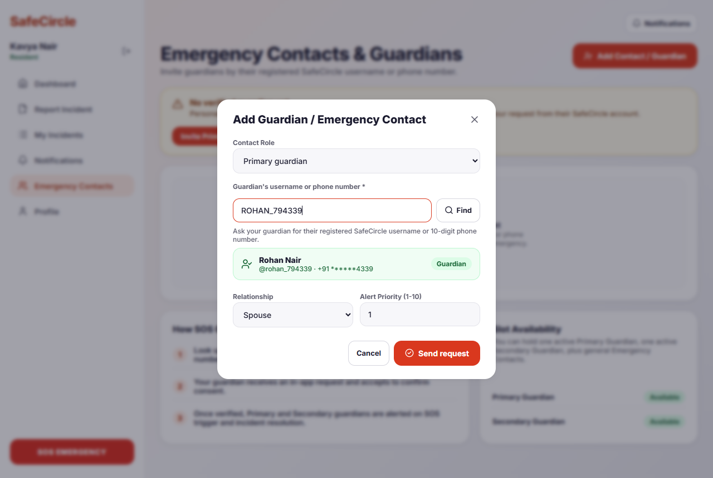
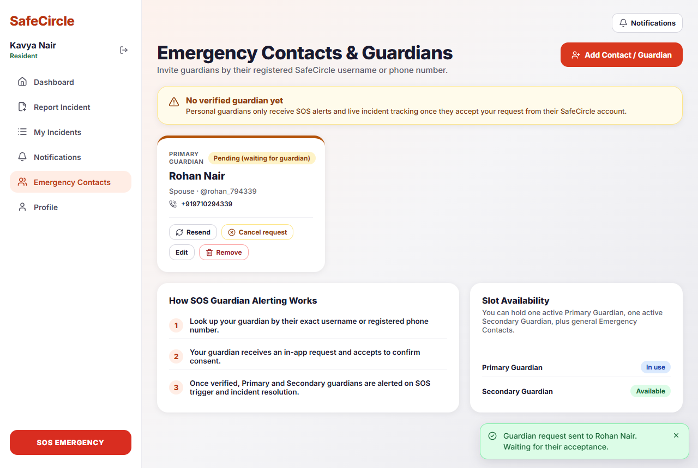
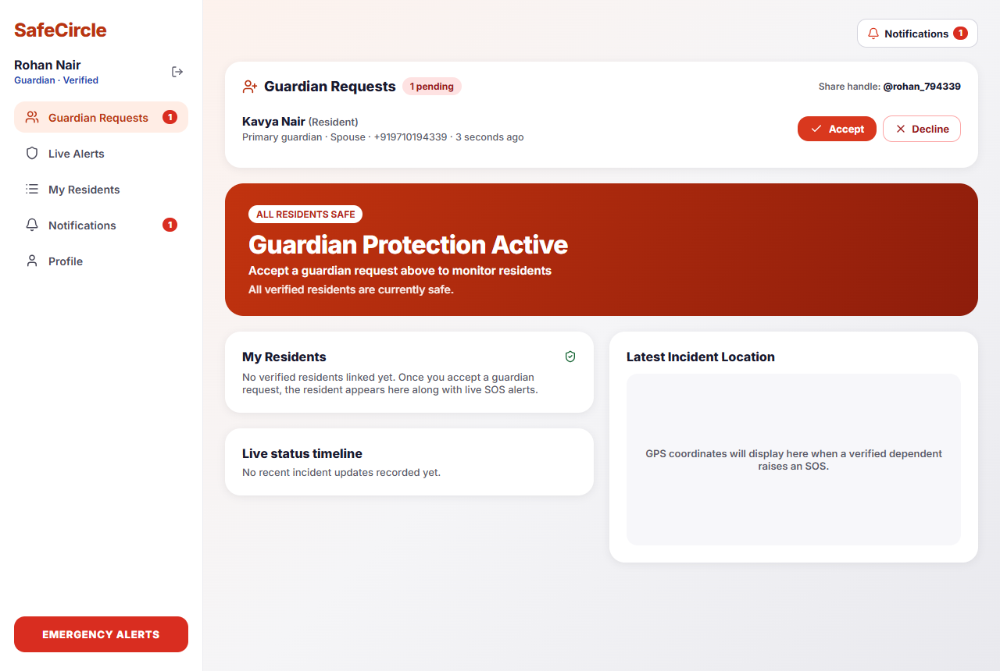
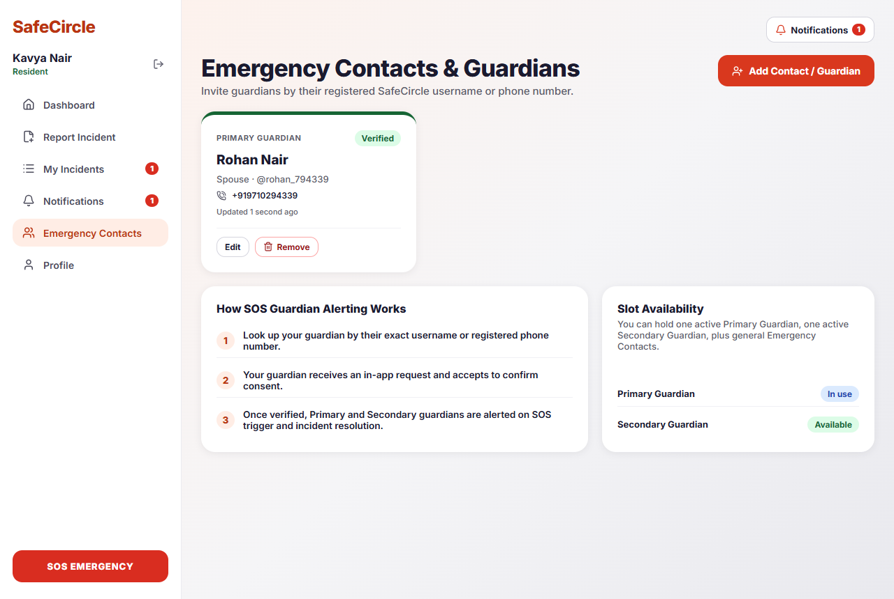

# Guardian & Emergency Contact End-to-End Flow Evidence

This document records the verification results for the real backend-backed Guardian / Emergency Contact consent, lookup, and uniqueness workflow across Django REST Framework + PostgreSQL (`backend/`) and React + TypeScript (`frontend/`).

## 1. Automated Test & Build Runs

| Check | Command | Latest Result |
| --- | --- | --- |
| Backend Django Test Suite (PostgreSQL) | `.\venv_local\Scripts\python.exe manage.py test --noinput -v 2` | `Ran 64 tests ... OK` (users: 5, contacts: 4, incidents + notifications: 55; 0 failures, 0 errors) |
| Duplicate User Data Check | `.\venv_local\Scripts\python.exe manage.py report_duplicate_phones` | `All user phone numbers and usernames are valid and unique.` |
| Django Production Deployment Check | `.\venv_local\Scripts\python.exe manage.py check --deploy` (`DJANGO_DEBUG=False`, SSL redirect & secure cookies enabled) | Exited `0` (9 pre-existing `drf_spectacular.W001` type-hint/enum warnings, 0 errors) |
| Frontend TypeScript + Production Build | `npm run build` (`tsc -b && vite build`) | Exited `0` (`976ms`, 18 PWA precache entries) |
| Frontend Linter | `npm run lint` (`oxlint`) | Exited `0` (`0` errors, `17` warnings) |
| Frontend Unit Tests (Vitest + Testing Library) | `npm test` (`vitest run`) | `2` files (`m3.test.tsx`, `guardian.test.tsx`), `8 passed (8)` |
| Newman API Collection (live Waitress WSGI on `127.0.0.1:8000`) | `npx -y newman run docs/postman/m3-collection.json -e docs/postman/environment.json` | `63` requests, `63` test-scripts, `104` assertions, `0` failed (`10.6s`, avg `93ms`) |
| Two-Account Browser E2E (Edge + Waitress + Vite Preview `127.0.0.1:4173`) | `node verify-guardian-e2e.mjs` | Exited `0` — all guardian, uniqueness, lookup, consent, SOS & slot-reuse checks passed |
| M3 Regression Browser E2E | `node verify-m3-e2e.mjs` | Exited `0` — resident report, PWA offline, admin assign, volunteer resolve, notifications passed |

Note: Full Newman output is saved in [`docs/evidence/newman-run.txt`](../evidence/newman-run.txt). Waitress WSGI server logs recorded zero `500` errors (only expected `400`/`401`/`403`/`404`/`410` responses for negative security checks).

---

## 2. Two-Real-Account Verification Walkthrough (Observed Checks 1–6)

Executed cleanly against PostgreSQL + Waitress WSGI (`http://127.0.0.1:8000`) + built Vite preview (`http://127.0.0.1:4173`) via `frontend/run-guardian-verify.ps1`:

1. **Duplicate / Format Registration Checks (`/register`):**
   - Registered Resident `@kavya_794339` (`9710194339` normalized to `+919710194339`).
   - Re-registering with formatted duplicate phone `"+91 97101-94339"` returned `400` (`{"phone": ["This phone number is already registered."]}`) rendered inline under the phone field.
   - Re-registering with case-insensitive duplicate username `"KAVYA_794339"` returned `400` (`{"username": ["This username is taken."]}`) rendered inline under the username field.
   - Registered Guardian 1 `@rohan_794339` (`9710294339`) and Guardian 2 `@ananya_794339` (`9710394339`).

2. **Exact-Match Lookup & Add by Username (`GET /api/users/lookup/?identifier=` + `POST /api/contacts/`):**
   - Negative lookups rejected: unknown identifier (`404 {"detail": "No account found with that username or phone."}`), non-guardian user (`400`), and resident's own identifier (`400`).
   - Resident entered case-variant `"ROHAN_794339"`, clicked `Find`, verified confirmation card (`Rohan Nair`, `@rohan_794339`, `+91 ******4339`, `Guardian` badge), and submitted `"Send request"`.
   - Card appeared immediately with chip `Pending (waiting for guardian)` while warning banner `No verified guardian yet` remained visible.

   
   

3. **Pre-Acceptance Isolation (`status='pending'`, `is_verified=False`):**
   - Resident raised an SOS before acceptance (Incident `#22`).
   - Guardian Rohan had `GET /api/incidents/22/` return `404` and did **not** receive an `SOS` notification for Incident `#22`.
   - Other guardian `@ananya_794339` calling `POST /api/guardian/requests/{id}/accept/` received `404`.
   - Retired resident self-verify endpoints `POST /api/contacts/{id}/verify/` and `resend-verification/` returned `410 Gone`.

4. **Guardian Acceptance, Verified State & Dependents (`POST /api/guardian/requests/{id}/accept/`):**
   - Guardian Rohan logged into `/guardian/alerts`, saw sidebar badge `Guardian Requests 1` and pending request card from `Kavya Nair` (`Primary guardian · Spouse · +919710194339`).
   - Clicking `Accept` moved Kavya into `My Residents` (`GET /api/guardian/dependents/`), set `status='accepted'`, `is_verified=True`, `verified_at`, `responded_at`, and sent `GUARDIAN_ACCEPTED` notification to Kavya.
   - Resident reloaded `/resident/contacts`: card updated to `Verified` and `No verified guardian yet` banner cleared.
   - Resident raised post-accept SOS (Incident `#23`): Guardian Rohan opened `/guardian/alerts` and viewed Incident `#23` cleanly.

   
   

5. **Phone Lookup, Decline, Request Again, Cancel & Slot Reuse:**
   - Resident removed Primary Guardian (`DELETE /api/contacts/{id}/`) and added Guardian 1 (`Rohan Nair`) using formatted phone `"+91 97102 94339"`.
   - Guardian 1 declined (`POST /api/guardian/requests/{id}/decline/`); Resident saw `Declined` chip, clicked `Request again` (`POST /api/contacts/{id}/resend/` -> `201`), then clicked `Cancel request` (`POST /api/contacts/{id}/cancel/` -> `200`).
   - Resident immediately re-added a Primary Guardian (`@ananya_794339`) without hitting any stale unique constraint block (`0` 500 errors).

---

## 3. Requirements Mapping

| Requirement | Backend / Frontend Implementation | Verification |
| --- | --- | --- |
| Case-insensitive unique username & normalized unique phone (`+91`) + pre-migration duplicate check | `backend/users/{validators.py,models.py,serializers.py}`, `0004_phone_username_constraints.py`, `report_duplicate_phones.py`; `frontend/src/lib/phone.ts`, `RegisterPage.tsx`, `ProfilePage.tsx` | `users/tests.py`, Newman Auth/`04`, `verify-guardian-e2e.mjs` step 1 |
| Exact-match throttled user lookup (`20/min`, masked phone, `404` on miss, active users only) | `GET /api/users/lookup/` in `backend/users/{views.py,urls.py,serializers.py}`, `config/settings.py`; `frontend/src/api/users.ts`, `ContactsPage.tsx` | `users/tests.py`, Newman Guardian `01–03`, `guardian.test.tsx`, `verify-guardian-e2e.mjs` step 2 |
| `EmergencyContact` status lifecycle (`pending`, `accepted`, `declined`, `cancelled`), server-copied identity, active-only partial constraints & data migration | `backend/contacts/{models.py,serializers.py,views.py}`, migrations `0002`, `0003`, `0004` | `contacts/tests.py`, Newman Guardian `05–06`, `10–13`, `verify-guardian-e2e.mjs` steps 2 & 4 |
| Guardian consent queue (`/api/guardian/requests/`, `/accept/`, `/decline/`, `/dependents/`) + `403`/`404` guards | `backend/contacts/{views.py,urls.py}`; `frontend/src/api/guardianRequests.ts`, `GuardianIncidentsPage.tsx`, `AppShell.tsx` | `contacts/tests.py`, Newman Guardian `08–15`, `guardian.test.tsx`, `verify-guardian-e2e.mjs` steps 3–4 |
| Resident cancel (`POST /api/contacts/{id}/cancel/`), resend/re-request (`POST /api/contacts/{id}/resend/`), retired self-verify (`410 Gone`) | `backend/contacts/{views.py,urls.py}`; `frontend/src/api/contacts.ts`, `ContactsPage.tsx` | `contacts/tests.py`, Newman Guardian `07`, `11–12`, `verify-guardian-e2e.mjs` steps 3–4 |
| Accepted-only SOS alerts, incident access & notifications (`GUARDIAN_REQUEST`, `GUARDIAN_ACCEPTED`, `GUARDIAN_DECLINED`, `incident=NULL`) | `backend/incidents/access.py`, `backend/notifications/{models.py,services.py,views.py}`, migration `0003`; `NotificationsPage.tsx`, `ResidentHomePage.tsx` | `contacts/tests.py`, `incidents/tests.py`, `notifications/tests.py`, `verify-guardian-e2e.mjs` step 3 |
| Zero localStorage mocks or hardcoded sample contacts | `guardianRequests.ts` rewritten against REST API; `ContactsPage.tsx`, `ResidentHomePage.tsx`, `ProfilePage.tsx` updated | `grep`/codebase check, `npm run build`, `npm test`, `verify-guardian-e2e.mjs` |
