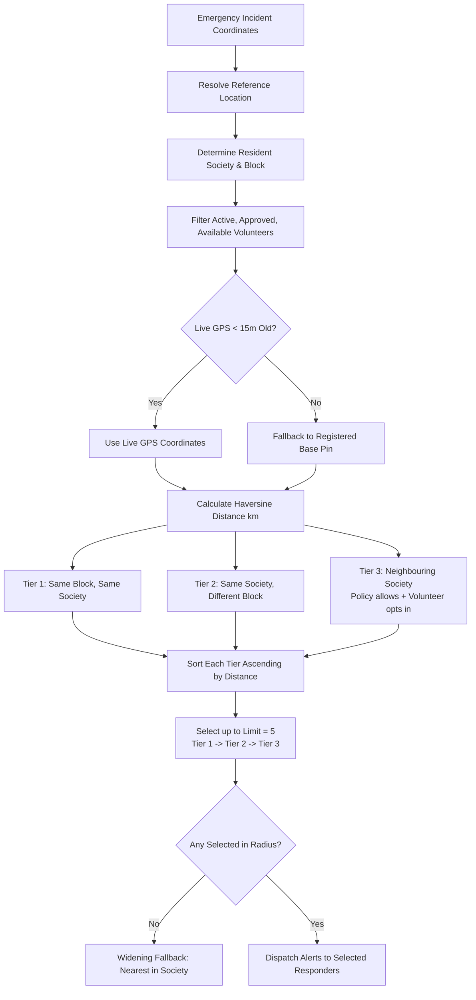

# SafeCircle — Block-First Volunteer Matching Engine Evidence

This document details the algorithm, proximity scoring, tiered ranking, fallbacks, and verification evidence for the SafeCircle Volunteer Matching Engine.

---

## 1. Matching Hierarchy & Fallbacks



---

## 2. Seeded Volunteer Topology & Verification Results

In our automated seed scenario (`seed_demo`):
- **Society 1 (Green Meadows):** Indiranagar, Bengaluru (Pin: 12.9716, 77.5946)
  - **Block A:** Resident Asha Rao (Flat 101)
    - **V1 (Priya Sharma):** Block A, Live GPS ~62m away (12.9720, 77.5950) -> **Tier 1, Rank 1**
    - **V2 (Kavita Patel):** Block A, Base Pin ~119m away (12.9725, 77.5952) -> **Tier 1, Rank 2**
    - **V10 (Rohan Joshi):** Block A, Base Pin ~148m away (12.9726, 77.5955) -> **Tier 1, Rank 3**
    - **V8 (Far Pin):** Block A, Base Pin ~4.2km away -> Flagged with `pin_far_from_society=True`
  - **Block B:**
    - **V3 (Arjun Verma):** Block B, Live GPS ~260m away (12.9735, 77.5960) -> **Tier 2, Rank 4**
    - **V4 (Rahul Sen):** Block B, Live GPS ~459m away (12.9750, 77.5970) -> **Tier 2, Rank 5**
    - **V5 (Deepa Nair):** Block B, Base Pin ~800m away (12.9760, 77.5980) -> Tier 2
    - **V9 (Pending):** Block B -> Skipped (Pending admin approval)
- **Society 2 (Palm Heights):** HAL 2nd Stage (~1.5 km from Green Meadows)
  - **V6 (Manish):** Live GPS ~1.4km away, `serves_nearby_societies=True` -> **Tier 3**
  - **V7 (Sneha):** Base Pin ~1.6km away, `serves_nearby_societies=True` -> **Tier 3**
  - **V11 (Naveen):** `serves_nearby_societies=False` -> Excluded from Tier 3

---

## 3. Verification Script Output (`demo_matching.py`)

```
================================================================================
 SafeCircle - Volunteer Matching Engine Demo
================================================================================
Resident: Asha Rao (@asha_resident)
Society : Green Meadows (Pin: 12.971600, 77.594600)
Location: Flat 101, Block A

Incident Target Coordinates: Lat 12.971600, Lng 77.594600
Radius configured          : 2.0 km

--------------------------------------------------------------------------------
 MATCHED & SELECTED VOLUNTEERS (Limit: 5, Ranked by Tier & Distance)
--------------------------------------------------------------------------------
  #1 [Tier 1 (Same Block)] Priya Sharma (@volunteer_demo)
      Distance : 0.062 km (Location source: live)
      Society  : Green Meadows | Block: Block A
      Coords   : (12.972000, 77.595000)
  #2 [Tier 1 (Same Block)] Kavita Patel (@vol_v2)
      Distance : 0.119 km (Location source: base)
      Society  : Green Meadows | Block: Block A
      Coords   : (12.972500, 77.595200)
  #3 [Tier 1 (Same Block)] Rohan Joshi (@vol_v10)
      Distance : 0.148 km (Location source: base)
      Society  : Green Meadows | Block: Block A
      Coords   : (12.972600, 77.595500)
  #4 [Tier 2 (Same Society)] Arjun Verma (@volunteer2_demo)
      Distance : 0.26 km (Location source: live)
      Society  : Green Meadows | Block: Block B
      Coords   : (12.973500, 77.596000)
  #5 [Tier 2 (Same Society)] Rahul Sen (@vol_v4)
      Distance : 0.459 km (Location source: live)
      Society  : Green Meadows | Block: Block B
      Coords   : (12.975000, 77.597000)

--------------------------------------------------------------------------------
 SUMMARY COUNTS
--------------------------------------------------------------------------------
  Tier 1 candidates (Same Block)   : 3
  Tier 2 candidates (Same Society) : 3
  Tier 3 candidates (Neighbours)   : 2
  Radius Widened                   : False

--------------------------------------------------------------------------------
 RESIDENT ESCALATION SETTINGS PREVIEW BREAKDOWN
--------------------------------------------------------------------------------
  Total eligible          : 10
  - Same block (Tier 1)   : 4
  - Same society (Tier 2) : 3
  - Neighbours (Tier 3)   : 3
  - Policy allows Tier 3  : True
================================================================================
```

---

## 4. Privacy & Safety Safeguards Verified

1. **Cross-Society Privacy Redaction:**
   - Unaccepted cross-society previews strip flat number, full description, phone number, and evidence photos. Only resident's first name, general category, GPS pin, and Google Maps link are sent. Full details unlock upon acceptance.
2. **Far Pin Warning (> 3.0 km):**
   - Admin approval dashboard highlights any volunteer whose base pin exceeds 3.0 km from society center to prevent fraudulent out-of-area registrations.
3. **Atomic Volunteer Claim (`POST /api/incidents/<id>/accept/`):**
   - First responder acquires the incident using database row locks (`select_for_update`).
   - Second responder receives HTTP 409 Conflict with the name of the assigned responder.

